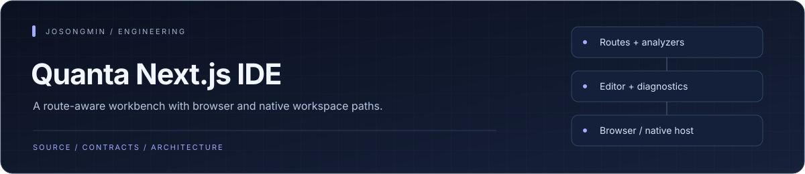
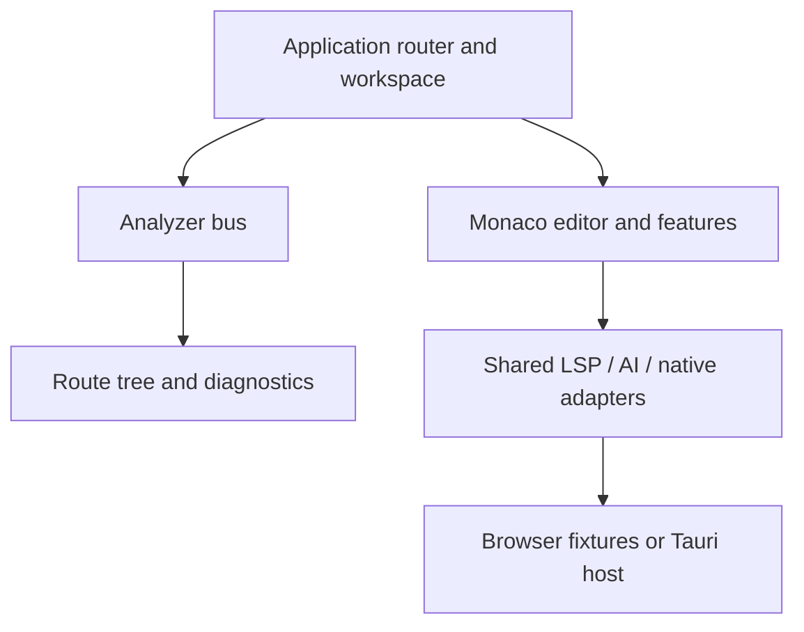

<p align="center"></p>

# Quanta Next.js IDE

<p align="center"><a href="#engineering-highlights">Engineering</a> · <a href="#architecture-at-a-glance">Architecture</a> · <a href="#run-locally">Get started</a> · <a href="#documentation">Reference</a></p>

An IDE interface for exploring Next.js development workflows and diagnostics. The application shell itself uses Vite, React, and TypeScript; Next.js execution and inspection are separate integration paths.

## Engineering highlights

| Mechanism | Engineering purpose | Source |
| :--- | :--- | :--- |
| **Route-aware analysis** | Analyzer registration, route-tree construction, and an analyzer bus connect project structure to UI diagnostics. | [Route analyzer](src/shared/analyzer/routes.ts) |
| **Editor and workspace boundary** | Monaco setup, save handling, workspace-root propagation, and native integration are separate modules. | [Composition](src/app/App.tsx) |
| **Feature-sliced UI** | Features, widgets, entities, and shared adapters separate presentation from reusable analysis and host concerns. | [Feature slices](src/features/) |
| **Separate realism tiers** | Browser fixtures, native workspace access, and real Next.js end-to-end tests are distinct execution paths. | [E2E fixtures](e2e/) |

## Architecture at a glance



## What it does

- Inspect project, file, and diagnostic information through feature-oriented screens.
- Explore developer tools including secret-scanner and webhook-testing interfaces.
- Develop components with Storybook and browser workflows with Playwright.
- Use the optional Tauri shell and the VS Code extension package.

## Repository map

| Path | Responsibility |
| --- | --- |
| [src/app](src/app) | Application composition. |
| [src/pages](src/pages) | Screen-level entry points. |
| [src/features](src/features) | Diagnostics and developer tools. |
| [src/entities](src/entities) | Domain models. |
| [src/shared](src/shared) | Shared UI, types, and demonstration data. |
| [packages/vscode-extension](packages/vscode-extension) | Editor integration. |
| [docs](docs) | Catalog and architecture review material. |

## Run locally

Use Node.js. Run these commands from the repository root.

```sh
npm ci
npm run dev
```

## Development checks

```sh
npm run typecheck
npm run lint
npm run build
```

```sh
npm run storybook
npm run test:e2e
npm run test:e2e:real
npm run tauri:dev
```

Playwright requires its browser environment. Desktop development additionally requires Rust and platform-specific dependencies.

## Scope and status

Mock findings, masked credentials, and sample diagnostics support UI development. They must be distinguished from results obtained from a real project. `test:e2e:real` selects the actual Next.js integration path; a regular UI build does not verify that path.

## Documentation

- [Feature catalog](docs/CATALOG.md)
- [Domain architecture](docs/AUDIT-DOMAIN.md)
- [Layer review](docs/AUDIT-FSD.md)
- [Script reference](package.json)

<p align="center"><sub><a href="https://github.com/josongmin">Project map</a> · <a href="#engineering-highlights">Back to overview</a></sub></p>
